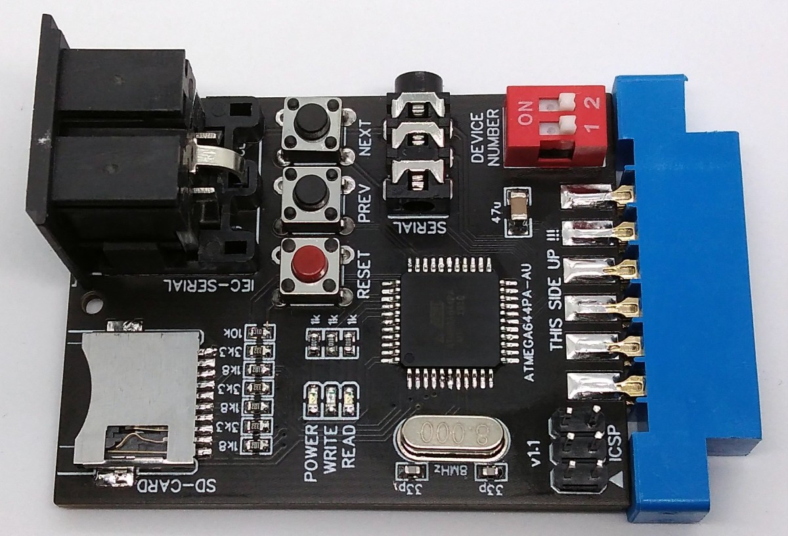
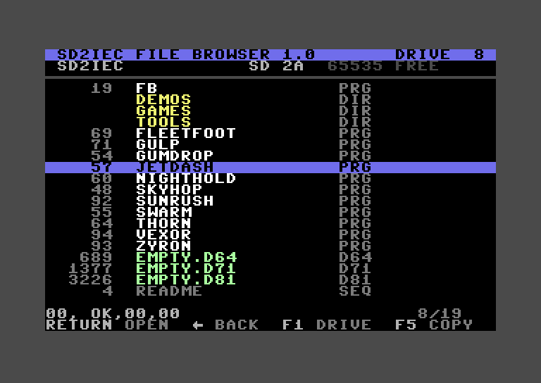
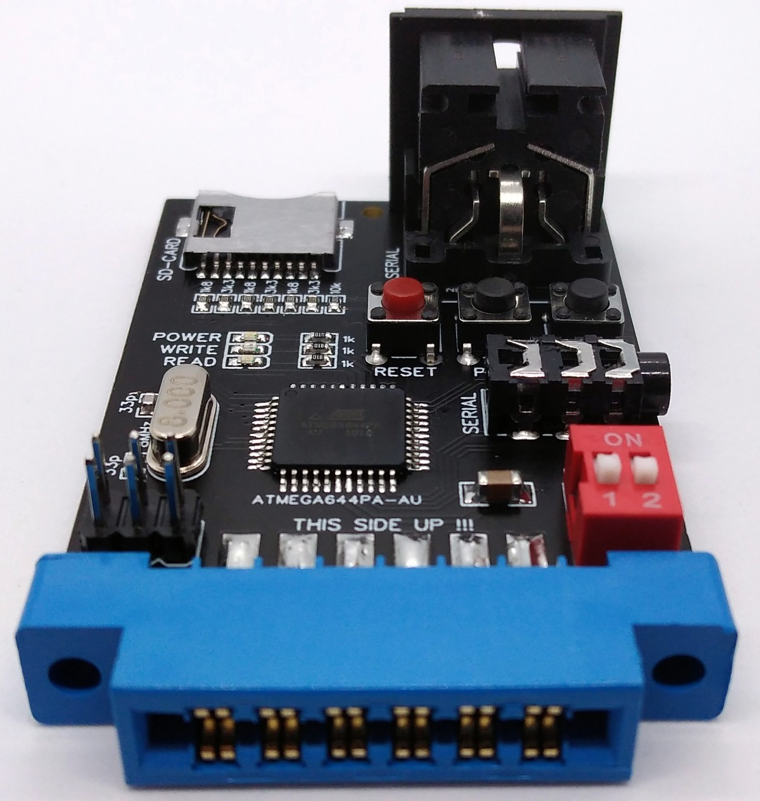

# SD2IEC - C64 SD Card Adapter
SD2IEC is a C64 SD card adapter and floppy disk drive emulator based on the design by [Lars Pontoppidan](https://larsee.com/blog/2007/02/the-mmc2iec-device/) with cassette port plug. Copy C64 games and programs to an SD card on your PC, put the card into your SD2IEC and load games and programs on your C64! The firmware was rewritten from scratch on the basis of the original [sd2iec](https://www.sd2iec.de) firmware by Ingo Korb: smaller, documented, configurable in one place, and with a new file browser for the C64.



The SD2IEC is connected to the serial (IEC) port of the C64 and behaves like a 1541 floppy disk drive with device address 8 to 11. It reads and writes PRG, SEQ and USR files, PC64 files (P00/S00/U00) and the disk images D64, D71 and D81. It understands the DOS commands of the Commodore drives, many commands of the CMD drives, JiffyDOS and a whole range of fast loaders, including the [EPYX FastLoad](https://github.com/wagiminator/C64-Collection/tree/master/C64_Cartridge_FreeLoad) cartridge. However, the SD2IEC is not a complete disk drive emulator: it cannot run the drive code of programs with their own fast loader (unless the loader is one of the supported ones), so not every game will work from the SD2IEC!

# Firmware
## Features
- Emulates the bus protocol of the 1541 with the timing of the original ROM, including the turnaround and EOI handling. The bus is acknowledged in an interrupt, so the C64 never waits.
- Reads FAT16 and FAT32 cards (SD and SDHC up to 32 GB, with or without a partition table), including long file names. Files and folders can be created, renamed and deleted.
- Mounts the disk images D64 (35 or 40 tracks, with or without error info), D71 and D81 like a disk in a drive. Images can be read, written and formatted; blocks are allocated like on a real 1541/1571/1581, so the BAM stays valid for other tools.
- Folders on the card are folders for the C64 as well (CMD style commands CD, MD, RD).
- Disk changes with the buttons: swap lists (AUTOSWAP.LST) or simply all images of a folder.
- JiffyDOS, including the fast JiffyDOS LOAD protocol, and the fast loaders of Turbodisk, Final Cartridge III, EXOS, DreamLoad, ULoad Model 3, GI Joe, EPYX FastLoad cartridge, GEOS, Wheels, Action Replay 6, ELoad, Nippon, Maniac Mansion/Zak McKracken, N0stalgia and Sam's Journey.
- Device address with the DIP switches or by software; settings are stored in the EEPROM.
- Sleep mode: the SD2IEC releases the bus completely (for fast loaders of other drives).
- Firmware updates from the SD card with the newboot bootloader.
- 41 KB of flash instead of 59 KB, with room for extensions.

## Structure
The firmware is written in plain C for avr-gcc, the time-critical bus routines of JiffyDOS and the fast loaders in assembler. The structure follows the [MCU Templates](https://github.com/wagiminator/MCU-Templates):

|File|Content|
|:-|:-|
|config.h|central configuration: pins, SD card, LEDs, buttons, DIP switches, DOS defaults, fast loaders|
|makefile|build and upload with avr-gcc and avrdude, firmware file for the bootloader|
|platformio.ini / sd2iec.ino|build with PlatformIO or the Arduino IDE (MightyCore)|
|src/main.c|initialization, card detection, buttons, sleep mode|
|src/iec.c|IEC bus: 1541 bus state machine, byte transfer, JiffyDOS, LISTEN/TALK handling|
|src/fastloader_ll.S|bus interrupt and cycle-exact transfer routines (JiffyDOS and fast loaders)|
|src/fastloader.c|detection of fast loaders (CRC of the drive code), drive ROM answers for M-R|
|src/fl_file.c|file based fast loaders (Turbodisk, FC3, ELoad, GI Joe, EPYX, AR6, N0stalgia, Sam's Journey)|
|src/fl_sector.c|sector based fast loaders (DreamLoad, ULoad Model 3, Nippon, MM/Zak)|
|src/fl_geos.c|GEOS and Wheels disk drivers|
|src/doscmd.c|commands on the command channel 15|
|src/fileops.c|OPEN on the data channels: files, directory listings, direct access buffers|
|src/buffers.c|channel buffers and the status channel (error messages)|
|src/cbmfs.c|CBM view of the FAT file system: names, wildcards, paths, P00 files, file types|
|src/image.c|disk images D64/D71/D81: directory, BAM, files, sectors, formatting|
|src/fat.c|FAT16/FAT32 file system with long file names and write support|
|src/sd.c, src/spi.c|SD card driver (SD v1, v2 and SDHC)|
|src/swap.c|disk swap lists and the folder mode|
|src/led.c, src/settings.c|LEDs and buttons, settings in the EEPROM|
|src/system.c, src/gpio.h|system tick, microsecond timer, delays, EEPROM, GPIO macros|
|tools/bootinfo.py|adds the boot information (device ID, CRC) to the firmware file for the bootloader|
|tools/mergehex.py|combines firmware and bootloader into one HEX file|

## How the Firmware Works
**The bus.** The C64 talks to its drives over three open collector lines: ATN, CLOCK and DATA. The SD2IEC drives them like a 1541 through the data direction register of port C (input = released, output low = pulled). When the C64 pulls ATN, a pin change interrupt pulls DATA within microseconds, just like the ATN acknowledge logic of the 1541. The main loop then follows the bus state machine of the 1541 ROM: it receives the command bytes under ATN (LISTEN, TALK, OPEN, CLOSE, secondary address), turns the bus around for TALK and transfers the data bytes bit by bit with the original handshakes and the EOI timeout. During the seventh bit of a command byte the C64 with JiffyDOS waits a little longer; the SD2IEC answers this with a short DATA pulse and from then on uses the JiffyDOS protocol, which transfers two bits at a time on CLOCK and DATA. These routines are counted to the cycle in assembler.

**Channels and buffers.** Every open channel (secondary address 0 to 14) gets one of six 256-byte buffers, the status channel 15 has its own one. A buffer holds one block of a file: when the C64 has read it, a refill function reads the next block from the card or the disk image, and when the C64 writes, a full buffer is written to the card. Directory listings are made on the fly in the same way, one line per entry, in the format of the 1541 (as BASIC program for LOAD"$",8 or raw for other channels).

**File systems.** The FAT layer works with a single 512-byte sector cache and writes changes back only when needed, which keeps the RAM usage low. The CBM layer above it translates between the C64 and the PC: PETSCII and ASCII names, wildcards (* and ?), file types (from the extension or the P00 header) and paths. A disk image is opened like a file and then serves as a second file system with BAM and directory of the Commodore DOS. Every DOS function (open, scratch, rename, ...) passes through a small dispatcher that calls the FAT or the image functions.

**Fast loaders.** Programs with a fast loader write their own code into the drive memory (M-W) and start it (M-E). The SD2IEC cannot run 6502 code, but it calculates a CRC of all data written with M-W. If the CRC belongs to a known loader, M-E starts a routine that speaks the transfer protocol of this loader, reading the requested files or sectors itself. Unknown drive code is answered with the error 98, UNKNOWN DRIVECODE, together with the CRC.

**Bootloader.** The newboot bootloader in the upper 4 KB of the flash looks for a firmware file in the root of the SD card at every power-up. If the device ID matches and the checksum is correct, it flashes the file, unless the same firmware is already installed. Then it starts the firmware.

## Configuration
All settings that depend on the hardware or change the behaviour are collected in [config.h](https://github.com/wagiminator/C64-Collection/blob/master/C64_SD2IEC_LP/software/sd2iec/config.h) next to the makefile:

|Setting|Default|Description|
|:-|:-|:-|
|PIN_IEC_ATN, _DATA, _CLOCK|PC0, PC1, PC2|IEC bus lines (all on one port)|
|PIN_SD_CS, PIN_SD_DETECT, PIN_SD_WP|PB4, PD2, PD6|SD card: chip select, card detect switch, write protect switch|
|SD_FAST_CLOCK|0|SPI clock F_CPU/4 = 2 MHz (0, safe with the resistor level shifters) or F_CPU/2 (1)|
|PIN_LED_BUSY, PIN_LED_ERROR, LED_ACTIVE_LOW|PA0, PA1, 1|LEDs and their polarity|
|PIN_KEY_NEXT, PIN_KEY_PREV|PA5, PA4|disk change buttons (to GND)|
|PIN_DIP_1, PIN_DIP_2, DEVICE_ADDR_BASE|PA2, PA3, 8|device address switches and base address|
|BUFFER_COUNT, COMMAND_LENGTH|6, 120|number of channel buffers, max. length of commands and names|
|DIR_LABEL, DIR_ID|"SD2IEC", "SD"|disk name and ID shown for folders of the card|
|SWAP_LIST_NAME|"AUTOSWAP.LST"|name of the swap list used by the buttons|
|DEF_EXT_MODE, DEF_EXT_HIDING|1, 0|default file extension mode (XE), see below|
|FL_...|1|enable (1) or disable (0) JiffyDOS and each fast loader|
|BOOT_DEVID|0x5053524C|device ID for the bootloader ("LRSP")|

# Installing the Firmware
An AVR ISP programmer (USBasp or USBtinyISP) is required to flash the firmware and the bootloader for the first time. Suitable programmers to build yourself, such as the picoISP, the picoAVR or the USB ISP programmer sticks, can be found in the [AVR-Programmer](https://github.com/wagiminator/AVR-Programmer) repository, otherwise a cheap [USBasp](https://aliexpress.com/wholesale?SearchText=usbasp) does the job as well. Remove the SD card and disconnect the SD2IEC from the C64, then connect the programmer to the PC via USB and to the ICSP header on the board.

The precompiled files are in [software/sd2iec/bin](https://github.com/wagiminator/C64-Collection/tree/master/C64_SD2IEC_LP/software/sd2iec/bin):

|File|Content|
|:-|:-|
|sd2iec_boot.hex|firmware and bootloader in one file: use this for the first installation|
|sd2iec.hex|firmware only|
|sd2iec.bin|firmware for updates from the SD card (via the bootloader)|
|newboot-0.4.1-larsp-m644p.hex|the bootloader alone|

The fuses are: **low 0xEF, high 0xD2, extended 0xFD**. They select the external 8 MHz crystal, a brown-out level of 2.7 V, keep the EEPROM when the chip is erased, switch JTAG off (it shares pins with the IEC bus) and let the chip start in the 4 KB boot section, where the bootloader lives. Note: the high fuse 0xD2 replaces the 0x91 of the original instructions, with which the bootloader was never started.

### Uploading in the Web Browser
The easiest way: open the [AVR ISP Programmer Web App](https://wagiminator.github.io/apps/avrisp/) in Chrome, Edge or Opera on a desktop computer. Nothing needs to be installed.
- Connect the programmer to the PC and to the SD2IEC, click "Choose programmer" and select it.
- Click "Read chip info", then set the fuses to low 0xEF, high 0xD2, extended 0xFD and click "Write changed fuses". (A new ATmega644 runs at 1 MHz until the fuses are set; choose a slow ISP clock if the chip does not answer.)
- Open sd2iec_boot.hex and click "Flash firmware".

### Uploading with the Python Tool avrprog
[avrprog.py](https://github.com/wagiminator/MCU-Flash-Tools/blob/main/avrprog.py) from the [MCU-Flash-Tools](https://github.com/wagiminator/MCU-Flash-Tools) is a small single-file tool for USBasp and USBtinyISP that detects the programmer and the chip automatically. Download it, install PyUSB (`pip install pyusb`) and run:
```
python3 avrprog.py -B 125kHz -l 0xef -H 0xd2 -E 0xfd
python3 avrprog.py -f sd2iec_boot.hex
```
The first command sets the fuses with a slow ISP clock (a new chip runs at 1 MHz), the second one flashes firmware and bootloader. Linux users need a udev rule for the programmer first, see the [avrprog description](https://github.com/wagiminator/MCU-Flash-Tools#avrprog).

### Uploading with avrdude
- Make sure you have installed [avrdude](https://learn.adafruit.com/usbtinyisp/avrdude).
- Open a terminal and navigate to the folder software/sd2iec/bin.
- Execute the following commands (if necessary replace "usbasp" with the programmer you use):
  ```
  avrdude -c usbasp -p m644p -B 10 -U lfuse:w:0xef:m -U hfuse:w:0xd2:m -U efuse:w:0xfd:m
  avrdude -c usbasp -p m644p -U flash:w:sd2iec_boot.hex:i
  ```

### Compiling and Uploading with the Makefile
- Install the toolchain: `sudo apt install build-essential gcc-avr avr-libc avrdude python3`
- Adjust config.h if necessary.
- Open a terminal in the folder software/sd2iec.
- Run `make fuses` once, then `make flash` (use `PROGRMR=...` for another programmer). `make all` builds all files in the bin folder, `make update` only the firmware file for the SD card.

### Compiling and Uploading with the Arduino IDE or PlatformIO
- Install [MightyCore](https://github.com/MCUdude/MightyCore).
- Open software/sd2iec/sd2iec.ino.
- Select board "ATmega644", variant "644P / 644PA", clock "External 8 MHz", BOD "2.7V", EEPROM "EEPROM retained", bootloader "No bootloader" and the programmer "USBasp (MightyCore)".
- Click "Upload Using Programmer". This installs the firmware without the bootloader (the chip is erased), so the firmware cannot be updated from the SD card afterwards. Use sd2iec_boot.hex as described above to get the bootloader back.

With PlatformIO, open the folder software/sd2iec and run "Upload" (platformio.ini).

## Firmware Updates from the SD Card
Once the bootloader is installed, new firmware versions are installed without a programmer: copy sd2iec.bin into the root folder of the SD card, insert the card and switch the C64 on. The green LED flickers for a few seconds while the bootloader writes the new firmware, then the SD2IEC starts as usual. The file can stay on the card; the bootloader only flashes it if it differs from the installed firmware. After your own changes to the source code, `make update` creates the new sd2iec.bin.

The original firmware files of [sd2iec.de](https://www.sd2iec.de/nightlies/) (…-larsp-m644p.bin) work with the same bootloader, if you ever want to go back.

If the red LED blinks and the green LED lights up briefly from time to time, while the SD2IEC does not answer on the bus, the bootloader has not found a valid firmware in the flash. Copy sd2iec.bin into the root folder of the SD card and switch the C64 off and on again: the bootloader installs it and starts it.

# Operating Instructions
## Preparing the SD Card
- Format the SD card (max. 32 GB) with the FAT32 file system on your PC (FAT16 works as well). Cards of 1 to 8 GB are the most reliable choice.
- Copy the files from [software/sdcard_root](https://github.com/wagiminator/C64-Collection/tree/master/C64_SD2IEC_LP/software/sdcard_root) to the root of the SD card:

  |File|Content|
  |:-|:-|
  |FB|the file browser for the C64 (see below)|
  |EMPTY.D64, EMPTY.D71, EMPTY.D81|empty, formatted disk images (copy and rename them to get a new disk)|

- Copy C64 programs and games (PRG files, disk images) to the card and organize them in folders as you like.
- Insert the card into the SD2IEC, plug the SD2IEC into the cassette port of the C64 (power) and connect the IEC cable to the serial port.

## LEDs and Buttons
|Element|Function|
|:-|:-|
|BUSY LED (green)|lights up while files are open|
|ERROR LED (red)|steady: data not yet written to the card; blinking: error (read the status to clear it)|
|NEXT|next disk image (swap list or folder)|
|PREV|previous disk image|
|NEXT + PREV|first disk image|
|hold NEXT or PREV for 2 s|sleep mode on/off: the SD2IEC releases the bus completely (red LED on)|
|hold PREV while switching on|card detect test: the red LED shows the card detect switch|

## DIP Switches
You can change the address of your SD2IEC with the DIP switches (or by software with U0>, see below):

|DIP1|DIP2|Address|
|:-|:-|:-|
|OFF|OFF|8|
|ON|OFF|9|
|OFF|ON|10|
|ON|ON|11|

## The File Browser FB
FB is a new file browser written for the SD2IEC. It shows the content of the current folder or disk image, changes into folders and images and starts programs with a single key press. It also copies files between drives and transfers disk images to and from a real floppy disk in a second drive, e.g. a 1541.



- Type: `LOAD"FB",8` <kbd>RETURN</kbd> and `RUN` <kbd>RETURN</kbd>
- Navigate with the cursor keys or with a joystick in port 2. Folders are yellow, disk images green, programs white.

|Key|Joystick|Function|
|:-|:-|:-|
|<kbd>CRSR</kbd> up/down|up/down|move the selection|
|<kbd>CRSR</kbd> left/right|left/right|page up/down|
|<kbd>RETURN</kbd>|fire|open the folder or disk image, start the program|
|<kbd>←</kbd> or <kbd>DEL</kbd>||back to the parent folder (or out of the disk image)|
|<kbd>/</kbd>||root folder of the card|
|<kbd>HOME</kbd>||first entry|
|<kbd>A</kbd>...<kbd>Z</kbd>, <kbd>0</kbd>...<kbd>9</kbd>||next entry that starts with this character|
|<kbd>F1</kbd>||next drive (8...15)|
|<kbd>F3</kbd>||read the folder again|
|<kbd>F5</kbd>||copy the selected file to another drive|
|<kbd>F7</kbd>||disk image ⇄ floppy disk (see below)|
|<kbd>@</kbd>||send a DOS command, e.g. `S:OLDFILE`, `MD:GAMES`, `N:MYDISK,01`|
|<kbd>C=</kbd>+<kbd>SHIFT</kbd>||upper/lower case characters (long file names with lower case letters)|
|<kbd>RUN/STOP</kbd>||back to BASIC|

Programs are started as if you had typed `LOAD"NAME",8,1` and `RUN`. If a program does not load to the start of BASIC, FB shows the matching `SYS` command at the screen instead; just press <kbd>RETURN</kbd>. FB remembers the position in each parent folder, so <kbd>←</kbd> brings you back exactly where you were.

**Copying disks with F7.** Connect a 1541 (or 1571) with a different device address to the bus. Select a D64 image in FB and press <kbd>F7</kbd>: after you have entered the address of the floppy drive, the image is written track by track to the disk in the floppy drive. If anything else is selected, F7 reads the floppy disk into a new image file (FB asks for its name and adds ".D64"). This way you can bring your old disks to the SD card and back, without a PC. On the PC, the same can be done with the adapters of the [C64-Collection](https://github.com/wagiminator/C64-Collection) and the [C64 Disk Transfer Web App](https://wagiminator.github.io/apps/d64-transfer/) (see below).

The source code [software/fb/fb.asm](https://github.com/wagiminator/C64-Collection/blob/master/C64_SD2IEC_LP/software/fb/fb.asm) is written for 64tass and can also be assembled, run and debugged in the browser with the [C64 Assembler Web App](https://wagiminator.github.io/apps/c64-assembler/).

## Loading without the Browser
- `LOAD"$",8` and `LIST`: show the current folder or disk image.
- `LOAD"NAME",8,1` and `RUN`: load and start a program.
- `OPEN1,8,15,"CD:GAMES":CLOSE1`: change into the folder GAMES.
- `OPEN1,8,15,"CD:DISK.D64":CLOSE1`: insert the disk image DISK.D64.
- `OPEN1,8,15,"CD:←":CLOSE1`: back to the parent folder or out of the disk image.

With JiffyDOS, the commands are even shorter: `@CD:GAMES`, `@$`, `/NAME` (LOAD), `%NAME` (LOAD with ,1), `↑NAME` (LOAD and RUN).

## DOS Commands
Commands are sent on the command channel 15, e.g. `OPEN1,8,15,"S:FILE":CLOSE1`. The status (error message) is read from the same channel; it also clears the blinking ERROR LED.

|Command|Function|
|:-|:-|
|`CD:name`, `CD:←`, `CD//`, `/name`|change into a folder or disk image, back, root folder|
|`CD//path/name`|change along a path from the root|
|`MD:name`, `RD:name`|create / remove (empty) folder|
|`S:name[,name...]`|scratch (delete) files, wildcards allowed|
|`R:new=old`|rename a file|
|`C:new=old[,old...]`|copy (and join) files|
|`N:name,id`|format the mounted disk image (FAT folders cannot be formatted)|
|`I`|initialize: read the card again (after a card change)|
|`V`|validate (nothing to do, answered with OK)|
|`B-R`, `B-W`, `B-P`, `B-A`, `B-F`, `U1`, `U2`|direct access to the sectors of a disk image|
|`U3`...`U8`, `M-E`|start drive code (only known fast loaders)|
|`M-R`, `M-W`|drive memory (only the addresses used for drive detection and fast loaders)|
|`P`|position in a file|
|`UI`, `UJ`|reset (UI- / UI+: VIC-20 timing on/off)|
|`U0>` + chr$(n)|change the device address to n (4...30)|
|`XE0`...`XE4`, `XE+`, `XE-`|file extension mode, extension hiding (see below)|
|`XJ+`, `XJ-`|JiffyDOS on/off|
|`XS:name`, `XS`|use the swap list "name" / no swap list|
|`XW`|store the settings (address, extension mode, JiffyDOS) in the EEPROM|
|`X`|show the settings in the status: `03,E1-J+,08,00`|
|`X?`|show the firmware version|

When opening files, the usual options of the Commodore DOS work: `@:name` (replace), `name,S,W` (type SEQ/PRG/USR, mode read/write/append), `*` (last or first file), `$:A*` and `$=P` (filtered directory) and `#` (buffer for direct access).

## File Names and Types
- Files on the card get their type from the extension: `NAME.PRG` is a PRG file named "NAME.PRG". Files without extension and with unknown extensions are PRG files.
- Long file names are shown if they have up to 16 characters, otherwise the short 8.3 name is shown (e.g. `LONGGA~1.PRG`).
- C64 file names that are not allowed on the PC, and SEQ/USR files, are stored in the PC64 format with a header (`NAME.S00`, `NAME.P00`). Their real C64 name is shown in the directory.
- The extension mode (XE) selects when the PC64 format is used: 0 = never, 1 = for SEQ/USR files (default), 2 = always, 3 = SEQ/USR files as `.SEQ`/`.USR` without header, 4 = like 3 and PRG files as `.PRG`. XE+ hides the extensions .PRG/.SEQ/.USR in the directory (automatically on in mode 3 and 4).
- Disk images (`.D64`, `.D71`, `.D81`) are shown as PRG files and mounted with CD.

## Disk Swapping
Many games come on several disks and ask to "turn the disk". Instead of typing CD commands, use the buttons:
- **Folder mode:** without a swap list, NEXT and PREV step through all disk images in the current folder. Put the disks of a game into their own folder and you are done.
- **Swap list:** a text file `AUTOSWAP.LST` in the folder lists the images, one per line (e.g. `GAME-SIDE1.D64`). Lines starting with ";" are comments. NEXT/PREV step through the list, both buttons go back to the first image. A list with another name is activated with `XS:name`.

The LEDs confirm each change: green for NEXT, red for PREV, both for the first image.

## Fast Loaders
JiffyDOS and the supported fast loaders are detected automatically, nothing needs to be set. Commonly used are:
- **JiffyDOS** in the C64 (and C128/VIC-20): about 10x faster loading and saving.
- **Cartridges:** [EPYX FastLoad](https://github.com/wagiminator/C64-Collection/tree/master/C64_Cartridge_FreeLoad) (and its clone FreeLoad), Final Cartridge III, Action Replay 6 (1581 mode), EXOS.
- **Programs:** GEOS and Wheels, Turbodisk, and games with DreamLoad, ULoad Model 3, GI Joe, Nippon, Maniac Mansion/Zak McKracken, N0stalgia or Sam's Journey loaders.

Programs with other loaders report the error 98 (UNKNOWN DRIVECODE) and usually hang. For these, look for a "one file" version (PRG) of the program, use the [C64 Packer Web App](https://wagiminator.github.io/apps/c64-packer/) to pack a program into a single self-starting PRG file, or use a real 1541.

## Programs to Start With
The [C64-Games](https://github.com/wagiminator/C64-Games) repository contains original games for the C64, each of them also as a single PRG file that loads fine from the SD2IEC (their D64 images use a fast loader with drive code, which the SD2IEC cannot execute). Copy the PRG files to the card and start them with FB. The "play" links start a game in the [C64 Emulator Web App](https://wagiminator.github.io/apps/c64-emulator/), so you can try it in the browser first.

|Game|Genre|PRG file|Browser|
|:-|:-|:-|:-|
|[ZYRON](https://github.com/wagiminator/C64-Games/tree/main/C64_Zyron)|horizontally scrolling shoot'em-up|[zyron.prg](https://github.com/wagiminator/C64-Games/raw/main/C64_Zyron/binaries/zyron.prg)|[play](https://wagiminator.github.io/apps/c64-emulator/?file=https://raw.githubusercontent.com/wagiminator/C64-Games/main/C64_Zyron/binaries/zyron.prg)|
|[VEXOR](https://github.com/wagiminator/C64-Games/tree/main/C64_Vexor)|vertically scrolling shoot'em-up with a trading post|[vexor.prg](https://github.com/wagiminator/C64-Games/raw/main/C64_Vexor/binaries/vexor.prg)|[play](https://wagiminator.github.io/apps/c64-emulator/?file=https://raw.githubusercontent.com/wagiminator/C64-Games/main/C64_Vexor/binaries/vexor.prg)|
|[SWARM](https://github.com/wagiminator/C64-Games/tree/main/C64_Swarm)|fixed-screen alien invasion shooter|[swarm.prg](https://github.com/wagiminator/C64-Games/raw/main/C64_Swarm/binaries/swarm.prg)|[play](https://wagiminator.github.io/apps/c64-emulator/?file=https://raw.githubusercontent.com/wagiminator/C64-Games/main/C64_Swarm/binaries/swarm.prg)|
|[GULP!](https://github.com/wagiminator/C64-Games/tree/main/C64_Gulp)|underwater feeding game|[gulp.prg](https://github.com/wagiminator/C64-Games/raw/main/C64_Gulp/binaries/gulp.prg)|[play](https://wagiminator.github.io/apps/c64-emulator/?file=https://raw.githubusercontent.com/wagiminator/C64-Games/main/C64_Gulp/binaries/gulp.prg)|
|[THORN](https://github.com/wagiminator/C64-Games/tree/main/C64_Thorn)|garden defence against the undead|[thorn.prg](https://github.com/wagiminator/C64-Games/raw/main/C64_Thorn/binaries/thorn.prg)|[play](https://wagiminator.github.io/apps/c64-emulator/?file=https://raw.githubusercontent.com/wagiminator/C64-Games/main/C64_Thorn/binaries/thorn.prg)|
|[SUNRUSH](https://github.com/wagiminator/C64-Games/tree/main/C64_Sunrush)|pseudo 3D racing game|[sunrush.prg](https://github.com/wagiminator/C64-Games/raw/main/C64_Sunrush/binaries/sunrush.prg)|[play](https://wagiminator.github.io/apps/c64-emulator/?file=https://raw.githubusercontent.com/wagiminator/C64-Games/main/C64_Sunrush/binaries/sunrush.prg)|
|[SKYHOP](https://github.com/wagiminator/C64-Games/tree/main/C64_Skyhop)|endless jumping game|[skyhop.prg](https://github.com/wagiminator/C64-Games/raw/main/C64_Skyhop/binaries/skyhop.prg)|[play](https://wagiminator.github.io/apps/c64-emulator/?file=https://raw.githubusercontent.com/wagiminator/C64-Games/main/C64_Skyhop/binaries/skyhop.prg)|
|[JETDASH](https://github.com/wagiminator/C64-Games/tree/main/C64_Jetdash)|side-scrolling jetpack game|[jetdash.prg](https://github.com/wagiminator/C64-Games/raw/main/C64_Jetdash/binaries/jetdash.prg)|[play](https://wagiminator.github.io/apps/c64-emulator/?file=https://raw.githubusercontent.com/wagiminator/C64-Games/main/C64_Jetdash/binaries/jetdash.prg)|
|[GUMDROP](https://github.com/wagiminator/C64-Games/tree/main/C64_Gumdrop)|match-three puzzle|[gumdrop.prg](https://github.com/wagiminator/C64-Games/raw/main/C64_Gumdrop/binaries/gumdrop.prg)|[play](https://wagiminator.github.io/apps/c64-emulator/?file=https://raw.githubusercontent.com/wagiminator/C64-Games/main/C64_Gumdrop/binaries/gumdrop.prg)|
|[NIGHTHOLD](https://github.com/wagiminator/C64-Games/tree/main/C64_Nighthold)|horde survival game|[nighthold.prg](https://github.com/wagiminator/C64-Games/raw/main/C64_Nighthold/binaries/nighthold.prg)|[play](https://wagiminator.github.io/apps/c64-emulator/?file=https://raw.githubusercontent.com/wagiminator/C64-Games/main/C64_Nighthold/binaries/nighthold.prg)|
|[FLEETFOOT](https://github.com/wagiminator/C64-Games/tree/main/C64_Fleetfoot)|endless runner in pseudo 3D|[fleetfoot.prg](https://github.com/wagiminator/C64-Games/raw/main/C64_Fleetfoot/binaries/fleetfoot.prg)|[play](https://wagiminator.github.io/apps/c64-emulator/?file=https://raw.githubusercontent.com/wagiminator/C64-Games/main/C64_Fleetfoot/binaries/fleetfoot.prg)|

More games and demos can be found at [c64games.de](https://www.c64games.de/) and [csdb.dk](https://csdb.dk/).

## Useful Web Apps
These apps run in the browser without installation and help to prepare the content of the card:

|Web App|Use with the SD2IEC|
|:-|:-|
|[C64 Emulator](https://wagiminator.github.io/apps/c64-emulator/)|try PRG files and disk images before copying them to the card|
|[C64 Disk Editor](https://wagiminator.github.io/apps/d64-editor/)|create and edit D64 images: add and remove files, arrange the directory|
|[C64 Disk Viewer](https://wagiminator.github.io/apps/d64-viewer/)|look into a D64 image, down to every track and sector|
|[C64 Disk Transfer](https://wagiminator.github.io/apps/d64-transfer/)|read real floppies into D64 images and write images back (with the adapters below)|
|[C64 Packer](https://wagiminator.github.io/apps/c64-packer/)|pack programs into single, self-starting PRG files that load faster|
|[C64 Assembler](https://wagiminator.github.io/apps/c64-assembler/)|write your own programs, e.g. modify FB|
|[AVR ISP Programmer](https://wagiminator.github.io/apps/avrisp/)|flash the firmware and set the fuses|

## Reading and Writing Floppy Disks on the PC
Your old disks can be turned into D64 images for the SD2IEC (and images written back to real disks) with a 1541 floppy drive and one of these USB adapters from the [C64-Collection](https://github.com/wagiminator/C64-Collection). The [C64 Disk Transfer Web App](https://wagiminator.github.io/apps/d64-transfer/) works with the first three directly in the browser:

|Adapter|Description|
|:-|:-|
|[DiskBuddy64](https://github.com/wagiminator/C64-Collection/tree/master/C64_DiskBuddy64)|minimal 1541 to USB adapter with its own fast loader (ATtiny)|
|[DiskMaster64](https://github.com/wagiminator/C64-Collection/tree/master/C64_DiskMaster64)|the same with a CH552, even smaller and cheaper|
|[DumpMaster64](https://github.com/wagiminator/C64-Collection/tree/master/C64_DumpMaster64)|1541 floppy drives and Datasettes in one adapter|
|[xu1541](https://github.com/wagiminator/C64-Collection/tree/master/C64_xu1541)|USB adapter for many CBM drives (1541, 1571, 1581) with OpenCBM|

Without a PC, FB copies disks between the SD2IEC and a floppy drive at the C64 (F7, see above).

# Notes
- The SD2IEC must not be connected to the C64 while flashing.
- Compared to the original sd2iec, the following rarely used features were left out: REL files, real-time clock commands, partitions, M2I and DNP images, the remote display, and the EEPROM file system.

# References, Links and Notes
1. [Original Project by Lars Pontoppidan](https://larsee.com/blog/2007/02/the-mmc2iec-device/)
2. [Original sd2iec Firmware by Ingo Korb](https://www.sd2iec.de) (GPL v2; this firmware is based on it and uses the same license)
3. [sd2iec Manual (original firmware)](https://www.sd2iec.de/sd2iec.html), [C64 OS SD2IEC Documentation](http://www.c64os.com/post/sd2iecdocumentation)
4. [MCU Templates](https://github.com/wagiminator/MCU-Templates)
5. [Web Apps: C64 Emulator](https://wagiminator.github.io/apps/c64-emulator/), [C64 Disk Editor](https://wagiminator.github.io/apps/d64-editor/), [C64 Disk Viewer](https://wagiminator.github.io/apps/d64-viewer/), [C64 Disk Transfer](https://wagiminator.github.io/apps/d64-transfer/), [C64 Packer](https://wagiminator.github.io/apps/c64-packer/), [C64 Assembler](https://wagiminator.github.io/apps/c64-assembler/), [AVR ISP Programmer](https://wagiminator.github.io/apps/avrisp/)
6. [C64-Collection: DiskBuddy64, DiskMaster64, DumpMaster64, xu1541, FreeLoad](https://github.com/wagiminator/C64-Collection)
7. [MCU-Flash-Tools: avrprog.py](https://github.com/wagiminator/MCU-Flash-Tools/blob/main/avrprog.py)
8. [AVR-Programmer](https://github.com/wagiminator/AVR-Programmer)
9. [C64-Games Repository](https://github.com/wagiminator/C64-Games)
10. [C64 Games](https://www.c64games.de/), [C64 Demos](https://csdb.dk/)


