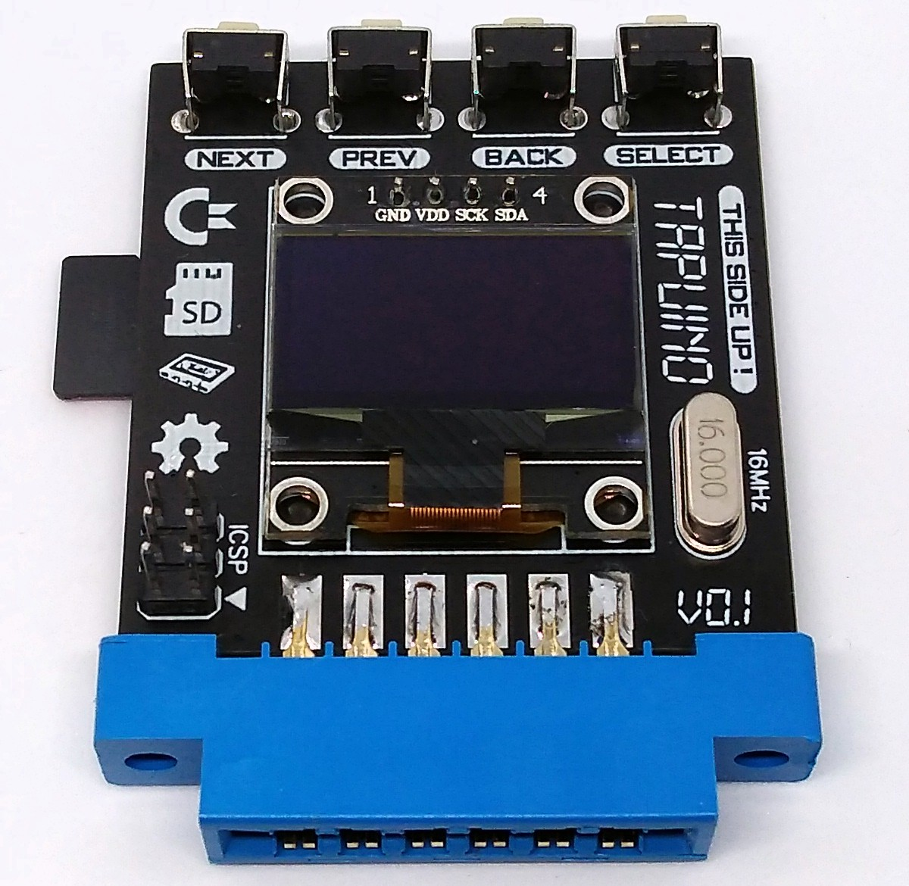
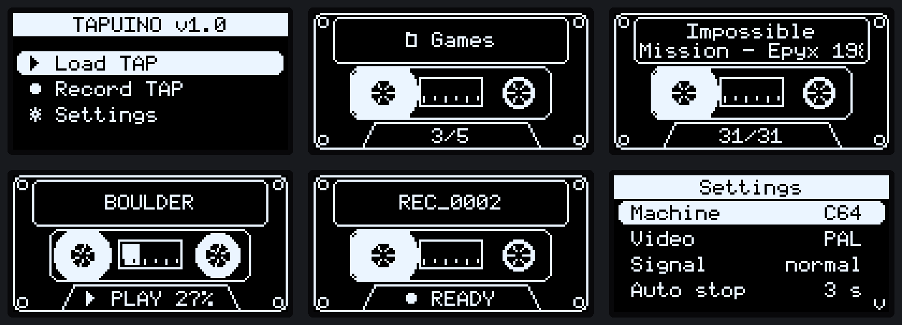
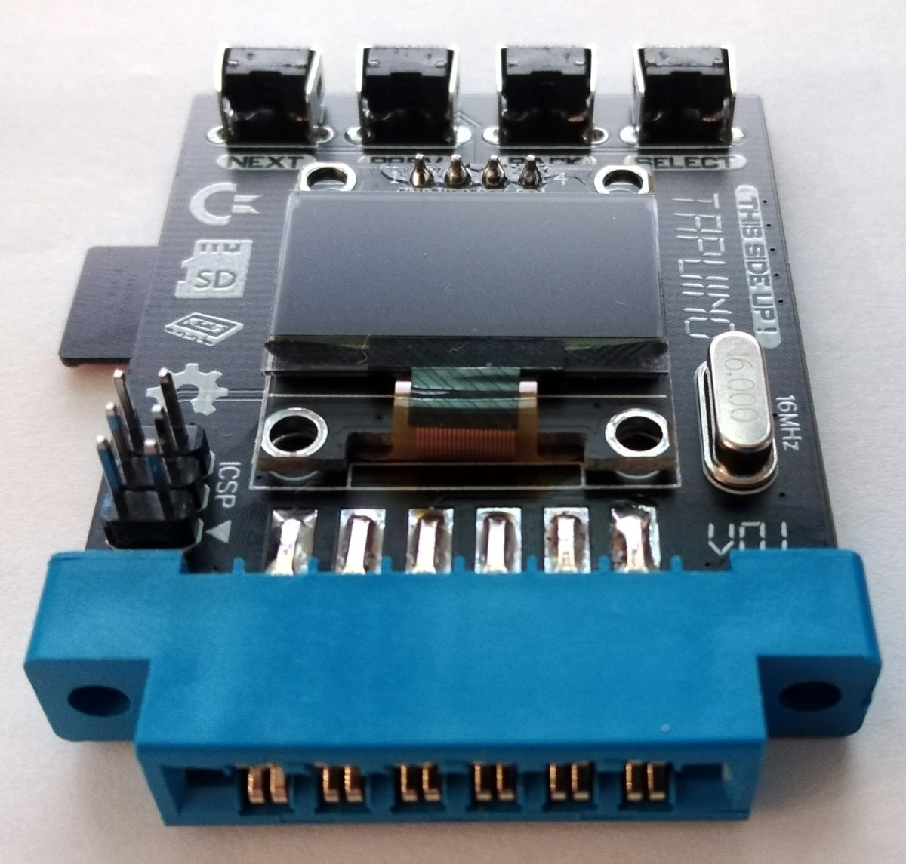
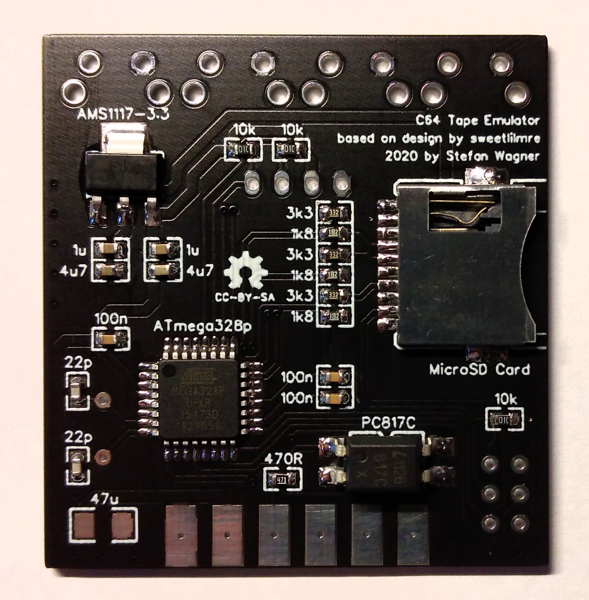
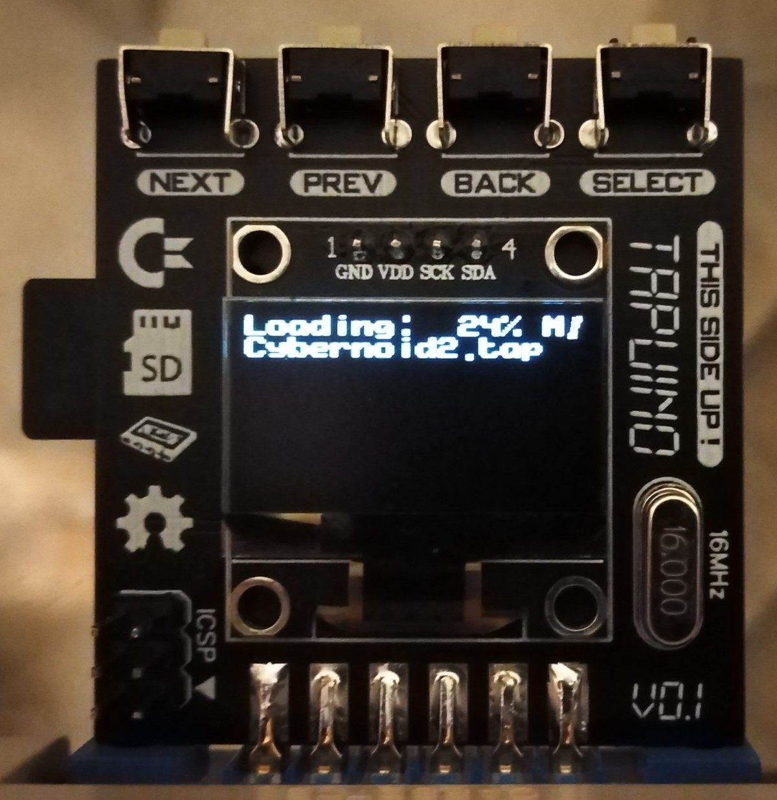
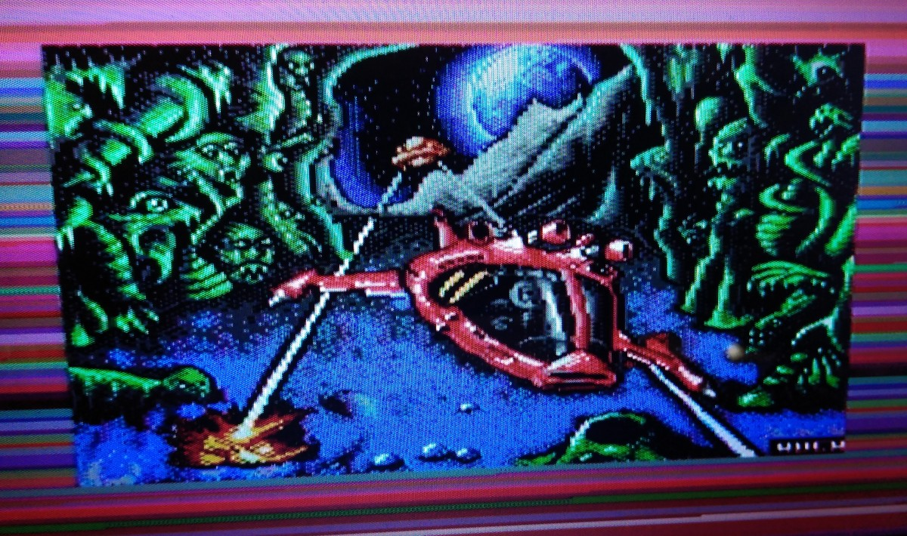

# Tapuino - Commodore Datasette Emulator
Tapuino is a Commodore Datasette emulator for C16, Plus/4, C64, C128 and VIC-20 based on the design by [Sweetlilmre](https://github.com/sweetlilmre/tapuino). Put your TAP files on an SD card and plug the device into your good old Commodore. The firmware was rewritten from scratch: the OLED shows a stylized cassette with the name of the selected TAP file on its label, the tape packs on the reels and a progress bar in the tape window move while the program is loading.



# Firmware
## Features
- Plays TAP files of version 0, 1 and 2 (half waves, C16/Plus/4) with exact pulse lengths, so turbo loaders work as well.
- Converts the pulse lengths for the clock of the machine and video standard given in the TAP header (C64, VIC-20, C16/Plus/4, each PAL or NTSC).
- Records programs saved by the computer as TAP files (version 1).
- Reads FAT16 and FAT32 cards (SD and SDHC), with or without a partition table, including long file names. Folders and TAP files are listed in alphabetical order, folders first.
- The whole 128x64 OLED is used for a stylized cassette:
  - the label shows the name of the file or folder (long names are split into two lines, the second line scrolls if necessary),
  - the tape packs on the reels move from the left to the right reel with the position on the tape, the reels turn while the motor is running,
  - the window between the reels shows a progress bar,
  - the head opening at the bottom shows the status (position in the folder, playback in percent, recorded kilobytes).
- Settings (machine and video standard for recordings, signal polarity, automatic stop, display contrast) are stored in the EEPROM.



## Structure
The firmware is written in plain C for avr-gcc. The structure follows the [MCU Templates](https://github.com/wagiminator/MCU-Templates):

|File|Content|
|:-|:-|
|config.h|central configuration: pins, display, folders, default settings, button timing|
|makefile|build and upload with avr-gcc and avrdude|
|platformio.ini / tapuino.ino|build with PlatformIO or the Arduino IDE (MiniCore)|
|src/main.c|application: menus, file browser, playback, recording, settings|
|src/tape.c|Datasette emulation: playback via timer 1 compare match, recording via input capture|
|src/fat.c|FAT16/FAT32 file system with sorted browsing, long file names and write support|
|src/sd.c, src/spi.c|SD card driver (SD v1, v2 and SDHC)|
|src/oled.c, src/i2c.c|SSD1306/SH1106 driver with page rendering (no frame buffer needed)|
|src/ui.c|screens: cassette, menus, name entry, messages|
|src/system.c, src/gpio.h|system tick, delays, EEPROM, GPIO macros|

## Configuration
All settings that depend on the hardware are collected in [config.h](https://github.com/wagiminator/C64-Collection/blob/master/C64_Tapuino/software/tapuino/config.h) next to the makefile:

|Setting|Default|Description|
|:-|:-|:-|
|PIN_KEY_NEXT ... PIN_KEY_SELECT|PC0 ... PC3|buttons (to GND)|
|PIN_TAPE_READ, _WRITE, _MOTOR, _SENSE|PD3, PB0, PD4, PD5|cassette port (WRITE must be on ICP1 = PB0)|
|PIN_SD_CS|PB2|chip select of the SD card|
|PIN_LED_REC|-|optional LED that lights up while recording|
|OLED_ADDR, OLED_SH1106, OLED_FLIP|0x3C, 0, 0|I2C address, 1.3" SH1106 display, display rotated by 180°|
|SD_FAST_CLOCK|1|SPI clock 8MHz (1) or 4MHz (0) for cards with long wires|
|REC_FOLDER, REC_PREFIX|"RECORD", "REC_"|folder and name of recordings (REC_0001.TAP ...)|
|DEF_...|C64, PAL, normal, 3s, 2|default settings until changed in the settings menu|
|KEY_...|450, 110, 700|button timing: repeat delay, repeat rate, long press (ms)|

## Installing the Firmware
An AVR ISP programmer (USBasp or USBtinyISP) is required to flash the firmware. Suitable programmers to build yourself, such as the picoISP, the picoAVR or the USB ISP programmer sticks, can be found in the [AVR-Programmer](https://github.com/wagiminator/AVR-Programmer) repository, otherwise a cheap [USBasp](https://aliexpress.com/wholesale?SearchText=usbasp) does the job as well. Connect the programmer to the PC via USB and to the ICSP header on the board.

The precompiled firmware is [software/tapuino/bin/tapuino.hex](https://github.com/wagiminator/C64-Collection/raw/master/C64_Tapuino/software/tapuino/bin/tapuino.hex). The fuses are: low 0xFF, high 0xDB, extended 0xFD.

### Uploading in the Web Browser
The easiest way: open the [AVR ISP Programmer Web App](https://wagiminator.github.io/apps/avrisp/) in Chrome, Edge or Opera on a desktop computer. Nothing needs to be installed.
- Connect the programmer to the PC and to the Tapuino, click "Choose programmer" and select it.
- Click "Read chip info", then set the fuses to low 0xFF, high 0xDB, extended 0xFD and click "Write changed fuses".
- Open tapuino.hex and click "Flash firmware".

### Uploading with the Python Tool avrprog
[avrprog.py](https://github.com/wagiminator/MCU-Flash-Tools/blob/main/avrprog.py) from the [MCU-Flash-Tools](https://github.com/wagiminator/MCU-Flash-Tools) is a small single-file tool for USBasp and USBtinyISP that detects the programmer and the chip automatically. Download it, install PyUSB (`pip install pyusb`) and run:
```
python3 avrprog.py -f tapuino.hex -l 0xff -H 0xdb -E 0xfd
```
Linux users need a udev rule for the programmer first, see the [avrprog description](https://github.com/wagiminator/MCU-Flash-Tools#avrprog).

### Uploading with avrdude
- Make sure you have installed [avrdude](https://learn.adafruit.com/usbtinyisp/avrdude).
- Open a terminal and navigate to the folder software/tapuino/bin.
- Execute the following command (if necessary replace "usbasp" with the programmer you use):
  ```
  avrdude -c usbasp -p m328p -U flash:w:tapuino.hex -U lfuse:w:0xff:m -U hfuse:w:0xdb:m -U efuse:w:0xfd:m
  ```

### Compiling and Uploading with the Makefile
- Install the toolchain: `sudo apt install build-essential gcc-avr avr-libc avrdude`
- Adjust config.h if necessary.
- Open a terminal in the folder software/tapuino.
- Run `make fuses` once, then `make flash` (use `PROGRMR=...` for another programmer).

### Compiling and Uploading with the Arduino IDE
- Install [MiniCore](https://github.com/MCUdude/MiniCore).
- Open software/tapuino/tapuino.ino.
- Select board "ATmega328", clock "External 16 MHz", BOD "2.7V", bootloader "No bootloader" and the programmer "USBasp (MiniCore)".
- Run "Burn Bootloader" once to set the fuses, then "Upload Using Programmer".

# Operating Instructions
## Buttons
|Button|Menus|File browser|Playback|Recording|
|:-|:-|:-|:-|:-|
|NEXT|next item|next file (hold to repeat)|-|-|
|PREV|previous item|previous file (hold to repeat)|-|-|
|SELECT|select / change value|open folder / play file|pause / continue|stop|
|BACK|back (saves settings)|parent folder, hold: main menu|stop|stop|

## Loading a TAP File
Copy your TAP files to the SD card and insert the card into the SD card slot. Folders can be used to sort your collection.

- Select "Load TAP" in the main menu.
- Browse to the desired file with NEXT and PREV, open folders with SELECT, go back with BACK.
- Press SELECT to insert the cassette. The Tapuino now acts like a Datasette with PLAY pressed.
- Enter "LOAD" on the computer and confirm with RETURN.

The reels turn while the computer runs the motor, the tape moves from the left to the right reel and the progress bar fills up. The status shows "PLAY" with the progress in percent, "WAIT" while the motor is off, "PAUSE" when paused with SELECT and "DONE" at the end of the tape. Press BACK to eject the cassette.

The machine (C64, VIC-20, C16/Plus/4) and video standard (PAL, NTSC) are taken from the header of the TAP file, so all files play at the right speed. Turbo loaders work as well, since the Tapuino reproduces the exact pulse lengths of the TAP file.

## TAP Files to Start With
The [C64-Games](https://github.com/wagiminator/C64-Games) repository contains original games for the C64, each of them also as a TAP file with a turbo loader. Copy them to the SD card and load them with the Tapuino. The "play" links start a game in the [C64 Emulator Web App](https://wagiminator.github.io/apps/c64-emulator/), so you can try it in the browser first.

|Game|Genre|TAP file|Browser|
|:-|:-|:-|:-|
|[ZYRON](https://github.com/wagiminator/C64-Games/tree/main/C64_Zyron)|horizontally scrolling shoot'em-up|[zyron.tap](https://github.com/wagiminator/C64-Games/raw/main/C64_Zyron/binaries/zyron.tap)|[play](https://wagiminator.github.io/apps/c64-emulator/?file=https://raw.githubusercontent.com/wagiminator/C64-Games/main/C64_Zyron/binaries/zyron.tap)|
|[VEXOR](https://github.com/wagiminator/C64-Games/tree/main/C64_Vexor)|vertically scrolling shoot'em-up with a trading post|[vexor.tap](https://github.com/wagiminator/C64-Games/raw/main/C64_Vexor/binaries/vexor.tap)|[play](https://wagiminator.github.io/apps/c64-emulator/?file=https://raw.githubusercontent.com/wagiminator/C64-Games/main/C64_Vexor/binaries/vexor.tap)|
|[SWARM](https://github.com/wagiminator/C64-Games/tree/main/C64_Swarm)|fixed-screen alien invasion shooter|[swarm.tap](https://github.com/wagiminator/C64-Games/raw/main/C64_Swarm/binaries/swarm.tap)|[play](https://wagiminator.github.io/apps/c64-emulator/?file=https://raw.githubusercontent.com/wagiminator/C64-Games/main/C64_Swarm/binaries/swarm.tap)|
|[GULP!](https://github.com/wagiminator/C64-Games/tree/main/C64_Gulp)|underwater feeding game|[gulp.tap](https://github.com/wagiminator/C64-Games/raw/main/C64_Gulp/binaries/gulp.tap)|[play](https://wagiminator.github.io/apps/c64-emulator/?file=https://raw.githubusercontent.com/wagiminator/C64-Games/main/C64_Gulp/binaries/gulp.tap)|
|[THORN](https://github.com/wagiminator/C64-Games/tree/main/C64_Thorn)|garden defence against the undead|[thorn.tap](https://github.com/wagiminator/C64-Games/raw/main/C64_Thorn/binaries/thorn.tap)|[play](https://wagiminator.github.io/apps/c64-emulator/?file=https://raw.githubusercontent.com/wagiminator/C64-Games/main/C64_Thorn/binaries/thorn.tap)|
|[SUNRUSH](https://github.com/wagiminator/C64-Games/tree/main/C64_Sunrush)|pseudo 3D racing game|[sunrush.tap](https://github.com/wagiminator/C64-Games/raw/main/C64_Sunrush/binaries/sunrush.tap)|[play](https://wagiminator.github.io/apps/c64-emulator/?file=https://raw.githubusercontent.com/wagiminator/C64-Games/main/C64_Sunrush/binaries/sunrush.tap)|
|[SKYHOP](https://github.com/wagiminator/C64-Games/tree/main/C64_Skyhop)|endless jumping game|[skyhop.tap](https://github.com/wagiminator/C64-Games/raw/main/C64_Skyhop/binaries/skyhop.tap)|[play](https://wagiminator.github.io/apps/c64-emulator/?file=https://raw.githubusercontent.com/wagiminator/C64-Games/main/C64_Skyhop/binaries/skyhop.tap)|
|[JETDASH](https://github.com/wagiminator/C64-Games/tree/main/C64_Jetdash)|side-scrolling jetpack game|[jetdash.tap](https://github.com/wagiminator/C64-Games/raw/main/C64_Jetdash/binaries/jetdash.tap)|[play](https://wagiminator.github.io/apps/c64-emulator/?file=https://raw.githubusercontent.com/wagiminator/C64-Games/main/C64_Jetdash/binaries/jetdash.tap)|
|[GUMDROP](https://github.com/wagiminator/C64-Games/tree/main/C64_Gumdrop)|match-three puzzle|[gumdrop.tap](https://github.com/wagiminator/C64-Games/raw/main/C64_Gumdrop/binaries/gumdrop.tap)|[play](https://wagiminator.github.io/apps/c64-emulator/?file=https://raw.githubusercontent.com/wagiminator/C64-Games/main/C64_Gumdrop/binaries/gumdrop.tap)|
|[NIGHTHOLD](https://github.com/wagiminator/C64-Games/tree/main/C64_Nighthold)|horde survival game|[nighthold.tap](https://github.com/wagiminator/C64-Games/raw/main/C64_Nighthold/binaries/nighthold.tap)|[play](https://wagiminator.github.io/apps/c64-emulator/?file=https://raw.githubusercontent.com/wagiminator/C64-Games/main/C64_Nighthold/binaries/nighthold.tap)|
|[FLEETFOOT](https://github.com/wagiminator/C64-Games/tree/main/C64_Fleetfoot)|endless runner in pseudo 3D|[fleetfoot.tap](https://github.com/wagiminator/C64-Games/raw/main/C64_Fleetfoot/binaries/fleetfoot.tap)|[play](https://wagiminator.github.io/apps/c64-emulator/?file=https://raw.githubusercontent.com/wagiminator/C64-Games/main/C64_Fleetfoot/binaries/fleetfoot.tap)|

The C64 Emulator Web App also opens any other TAP file (and the recordings of the Tapuino) with its virtual Datasette, which is handy to check a file before copying it to the card.

## Saving a File
- Select "Record TAP" in the main menu.
- The name of the new file is preset with the next free number (e.g. REC_0005). Change it if you like:
  |Button|Function|
  |:-|:-|
  |NEXT / PREV|change the letter at the cursor (A-Z, 0-9, _ and -)|
  |SELECT|move the cursor to the next position|
  |BACK|delete the letter at the cursor / before the cursor|
  |hold SELECT|confirm the name|
  |hold BACK|cancel|
- The cassette with the new name appears with the status "READY". The Tapuino now acts like a Datasette with RECORD and PLAY pressed.
- Enter "SAVE" (or "SAVE "NAME"") on the computer and confirm with RETURN.
- The status shows the recorded kilobytes. The recording ends automatically a few seconds after the computer has stopped the motor (see settings), or when you press SELECT or BACK.

The recordings are stored in the folder "RECORD" on the SD card and can be loaded from there like any other TAP file. On the PC, they can be checked in the [C64 Emulator Web App](https://wagiminator.github.io/apps/c64-emulator/), viewed and cleaned up in the [C64 Tape Transfer Web App](https://wagiminator.github.io/apps/tap-transfer/) or written to a real cassette (see below).

## Settings
|Setting|Values|Description|
|:-|:-|:-|
|Machine|C64, VIC-20, C16/+4|machine for recordings (clock for converting the pulse lengths)|
|Video|PAL, NTSC|video standard for recordings|
|Signal|normal, invert|polarity of the signals, if your computer or adapter inverts them|
|Auto stop|off, 2 ... 20 s|end a recording when the motor has been off for this time|
|Contrast|1 ... 4|brightness of the display|

The settings are stored when you leave the menu with BACK.

## Converting Programs to TAP Format
Not every program can be found in TAP format, but programs in other formats can be converted to TAP. The quickest way is the [C64 Packer Web App](https://wagiminator.github.io/apps/c64-packer/): open a PRG file, choose the tape image with a fast loader and save it as a .tap file. The program is packed (Exomizer or TSCrunch), loads about eight times faster than with the normal ROM loader and starts by itself after LOAD.

Alternatively, the small Windows program [WAV-PRG](http://wav-prg.sourceforge.net/wavprg.html) enables PRG, P00- and T64 files to be converted into TAP format. After opening the program, choose the second option "Convert a PRG, P00 or T64 to a sound or TAP or WAV" and click "OK". Now select the machine for which the file is to be converted from the drop-down menu, e.g. C64 PAL and click "OK". Now select the file to be converted. That's it, the TAP file is now ready for use with the Tapuino.

## Dumping Tapes from your old Datasette
If you still have old tapes and a Commodore Datasette, you can turn them into TAP files and play them with the Tapuino. The [C64 Tape Transfer Web App](https://wagiminator.github.io/apps/tap-transfer/) reads a cassette into a TAP file directly in the browser, shows every pulse and cleans up worn recordings. It works with these adapters from the [C64-Collection](https://github.com/wagiminator/C64-Collection), which connect a Datasette to the PC via USB:

|Adapter|Read tapes|Write tapes|
|:-|:-|:-|
|[TapeBuddy64](https://github.com/wagiminator/C64-Collection/tree/master/C64_TapeBuddy64)|yes|yes|
|[TapeDump64](https://github.com/wagiminator/C64-Collection/tree/master/C64_TapeDump64)|yes|no|
|[DumpMaster64](https://github.com/wagiminator/C64-Collection/tree/master/C64_DumpMaster64)|yes|yes (also 1541 floppy drives)|

The other way round works as well: TAP files, e.g. recordings of the Tapuino, can be written back to a real cassette with the TapeBuddy64 or DumpMaster64.

# References, Links and Notes
1. [Original Tapuino by Sweetlilmre](https://github.com/sweetlilmre/tapuino)
2. [Tapuino Tutorial (german)](https://www.mingos-commodorepage.com/tutorials/c64tapuino.php?title=Der%20Tapuino%20im%20Selbstbau)
3. [MCU Templates](https://github.com/wagiminator/MCU-Templates)
4. [Web Apps: C64 Emulator](https://wagiminator.github.io/apps/c64-emulator/), [C64 Tape Transfer](https://wagiminator.github.io/apps/tap-transfer/), [C64 Packer](https://wagiminator.github.io/apps/c64-packer/), [AVR ISP Programmer](https://wagiminator.github.io/apps/avrisp/)
5. [C64-Collection: TapeBuddy64, TapeDump64, DumpMaster64](https://github.com/wagiminator/C64-Collection)
6. [MCU-Flash-Tools: avrprog.py](https://github.com/wagiminator/MCU-Flash-Tools/blob/main/avrprog.py)
7. [AVR-Programmer](https://github.com/wagiminator/AVR-Programmer)
8. [C64-Games Repository](https://github.com/wagiminator/C64-Games)
9. [C64 Games](https://www.c64games.de/)





